# Diabetes Prediction Using Bioinformatics and Computational Biology

## 1. Title and Abstract

### Diabetes Prediction Using Bioinformatics and Computational Biology

**Course:** IT4133 – Bioinformatics and Computational Biology  
**Project:** Diabetes Prediction  
**Programming Language:** R  
**Dataset:** Pima Indians Diabetes Dataset

### Abstract

Diabetes mellitus is a chronic metabolic condition associated with elevated blood glucose levels and various long-term health complications. This project investigates the application of computational and statistical techniques to identify patterns associated with diabetes using clinical measurements from the Pima Indians Diabetes Dataset.

The analysis includes data importation, cleaning, missing-value treatment, exploratory data analysis, statistical testing, and predictive modelling. Five supervised classification methods—Logistic Regression, Naive Bayes, Decision Tree, k-Nearest Neighbours, and Support Vector Machine—are evaluated alongside K-means clustering.

Statistical procedures include normality assessment, group comparisons, variance testing, correlation analysis, and effect-size calculations. Model performance is assessed using accuracy, sensitivity, specificity, precision, F1-score, and the Area Under the Receiver Operating Characteristic Curve (ROC-AUC).

The statistical analysis identified significant differences between the diabetes outcome groups across all eight clinical variables using both Welch's t-tests and Wilcoxon rank-sum tests. Logistic Regression achieved the highest ROC-AUC of 0.8911 and an accuracy of approximately 80.52% on the testing dataset.

---

## 2. Introduction

Diabetes mellitus is a metabolic disorder characterized by elevated blood glucose levels resulting from problems with insulin production, insulin action, or both. Early identification of individuals who may have an increased likelihood of diabetes is important for supporting further medical assessment and appropriate healthcare decisions.

Bioinformatics and computational biology provide analytical approaches for investigating biological and clinical datasets. Statistical analysis and computational methods can be used to identify relationships among clinical measurements, discover patterns, and evaluate the ability of different methods to distinguish between observed health outcomes.

The main objective of this project is to investigate the relationship between selected clinical measurements and diabetes outcomes using the Pima Indians Diabetes Dataset. The project follows a structured analytical workflow using the R programming language.

### Project Objectives

The specific objectives are:

1. Import and examine the diabetes dataset.
2. Identify and handle missing or invalid clinical measurements.
3. Prepare the dataset for statistical and computational analysis.
4. Explore the distributions and relationships among clinical variables.
5. Investigate differences between the two diabetes outcome groups using statistical tests.
6. Apply different computational methods to classify diabetes outcomes.
7. Apply K-means clustering to investigate patterns in the clinical measurements.
8. Compare the results using appropriate evaluation metrics.
9. Identify the method that demonstrates the strongest performance in the selected testing dataset.

### Research Questions

This project addresses the following questions:

- What patterns can be identified in the clinical measurements of individuals with and without diabetes?
- Are there statistically significant differences in selected clinical variables between the two outcome groups?
- Which evaluated computational method achieves the highest classification performance?
- How effectively can the selected clinical measurements distinguish between the two diabetes outcome categories?

---

## 3. Data

### Dataset Description

This project uses the Pima Indians Diabetes Dataset. The dataset is available through the Plotly public datasets repository:

**Dataset URL:**  
https://raw.githubusercontent.com/plotly/datasets/master/diabetes.csv

The dataset contains 768 observations and nine columns, including eight clinical predictor variables and one binary outcome variable.

The original dataset concerns female patients of Pima Indian heritage aged 21 years or older. Consequently, the findings should not be assumed to represent all populations.

### Variables

| Variable | Description |
|---|---|
| Pregnancies | Number of times pregnant |
| Glucose | Plasma glucose concentration |
| BloodPressure | Diastolic blood pressure |
| SkinThickness | Triceps skinfold thickness |
| Insulin | Two-hour serum insulin |
| BMI | Body mass index |
| DiabetesPedigreeFunction | Diabetes pedigree function |
| Age | Age in years |
| Outcome | Diabetes status (0 = No Diabetes, 1 = Diabetes) |

The eight clinical measurements are used as predictor variables. The Outcome variable represents the target classification.

### Dataset Distribution

| Outcome | Observations | Percentage |
|---|---:|---:|
| No Diabetes | 500 | 65.10% |
| Diabetes | 268 | 34.90% |
| **Total** | **768** | **100%** |

### Data Quality and Preprocessing

Certain clinical measurements contain zero values that are not physiologically plausible for the corresponding variables. In particular, zero values in Glucose, BloodPressure, SkinThickness, Insulin, and BMI were treated as missing observations.

The preprocessing workflow includes:

- Identifying invalid zero values.
- Converting the identified values into missing observations.
- Applying median imputation to prepare the primary clinical dataset.
- Applying k-nearest-neighbour imputation as an additional preprocessing approach.
- Standardizing clinical measurements where required.
- Applying Min-Max normalization as an additional transformation.
- Checking for missing values and duplicate observations.

The cleaned dataset contains 768 observations and 25 columns, including the original variables and additional processed representations.

The primary statistical and predictive analyses use the median-imputed clinical measurements. Standardization for predictive modelling is calculated using training observations only, and the same parameters are applied to the testing observations to avoid information leakage.

### Ethical Considerations

This project uses an existing publicly accessible dataset and does not involve collecting new patient information or conducting experiments involving human participants.

The dataset contains health-related information, so its use should remain limited to educational and research purposes. The original source and repository should be acknowledged. Users should also check the applicable dataset licensing and usage conditions before redistributing the data.

The results are not intended to replace professional medical diagnosis or clinical assessment.

---

## 4. Methods

The project was implemented using the R programming language. The workflow is divided into five independent scripts stored in the `code/` directory.

### 4.1 Data Importation

The first script, `01_data_import.R`, retrieves the dataset from the public repository, imports it into R, examines its structure, and performs initial validation.

The imported dataset is saved in RDS format for subsequent processing.

### 4.2 Data Cleaning and Preprocessing

The second script, `02_data_cleaning.R`, performs data-quality checks and prepares the clinical measurements.

The preprocessing methods include median imputation, k-nearest-neighbour imputation, standardization, and Min-Max normalization.

The resulting cleaned dataset and preprocessing information are saved in the `data/` directory.

### 4.3 Exploratory Data Analysis

The third script, `03_exploratory_analysis.R`, investigates the characteristics and distributions of the clinical variables.

The analysis includes:

- Descriptive statistics.
- Outcome distribution analysis.
- Histograms and density plots.
- Boxplots grouped by diabetes outcome.
- Correlation analysis.
- Scatterplot analysis of selected clinical measurements.
- Comparison of age and glucose distributions between outcome groups.

The resulting charts are saved in the `figures/` directory, while statistical summaries are exported as CSV files.

### 4.4 Statistical Testing

The fourth script, `04_statistical_testing.R`, investigates differences and associations among clinical measurements.

The statistical procedures include:

- Shapiro-Wilk tests for normality assessment.
- Welch's independent-samples t-tests.
- Wilcoxon rank-sum tests.
- Fligner-Killeen tests for variance comparisons.
- Pearson correlation analysis.
- Spearman correlation analysis.
- Benjamini-Hochberg adjustment for multiple statistical comparisons.
- Cohen's d effect-size calculations.

The statistical outputs are saved as CSV files and graphical summaries.

### 4.5 Predictive Modelling

The fifth script, `05_predictive_modelling.R`, evaluates six computational methods.

The dataset is divided into training and testing subsets using stratified sampling.

- Training dataset: 614 observations (approximately 80%).
- Testing dataset: 154 observations (approximately 20%).

The training subset contains 400 observations without diabetes and 214 with diabetes. The testing subset contains 100 observations without diabetes and 54 with diabetes.

The following methods are evaluated:

**1. Logistic Regression**

Logistic Regression estimates the probability of a binary outcome using a logistic function. It is used to investigate the relationship between the clinical measurements and diabetes status.

**2. Naive Bayes**

Naive Bayes applies Bayes' theorem and assumes conditional independence among predictor variables given the outcome category.

**3. Decision Tree**

The Decision Tree method uses a sequence of decision rules based on clinical measurements to assign observations to outcome categories.

**4. k-Nearest Neighbours**

The k-NN method classifies an observation using the outcome categories of its nearest observations. The selected value for k is five.

**5. Support Vector Machine**

The Support Vector Machine method identifies a decision boundary between outcome categories. A radial basis function kernel is used in this project.

**6. K-means Clustering**

K-means is an unsupervised clustering method that groups observations according to similarities in their clinical measurements. Two clusters are generated. For comparison with the observed outcomes, each training cluster is assigned its majority outcome category. Testing observations are assigned to their nearest training cluster centre.

Unlike the other five methods, K-means does not directly learn from labelled outcomes. Its results are therefore interpreted as an exploratory clustering comparison rather than an equivalent supervised classification experiment.

### 4.6 Evaluation Metrics

The methods are compared using the following metrics:

| Metric | Purpose |
|---|---|
| Accuracy | Overall proportion of correctly classified observations |
| Sensitivity | Proportion of diabetes cases correctly identified |
| Specificity | Proportion of non-diabetes cases correctly identified |
| Precision | Proportion of predicted diabetes cases that are actual diabetes cases |
| F1-score | Harmonic mean of precision and sensitivity |
| ROC-AUC | Measures the ability to distinguish between the two outcome categories across classification thresholds |

Confusion matrices and Receiver Operating Characteristic (ROC) curves are also generated to support the evaluation.

---

## 5. Results

### 5.1 Exploratory Data Analysis

Exploratory analysis was conducted to understand the distribution of the clinical variables and identify possible relationships with diabetes outcomes.

The generated figures include outcome distribution, clinical variable histograms, density plots, boxplots, correlation heatmaps, and selected scatterplots.

**Outcome distribution**

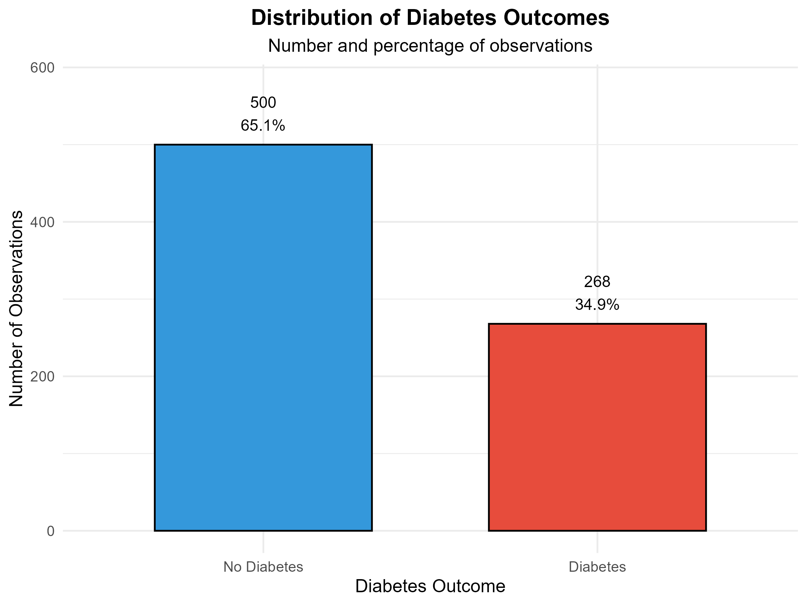

**Clinical variable distributions**

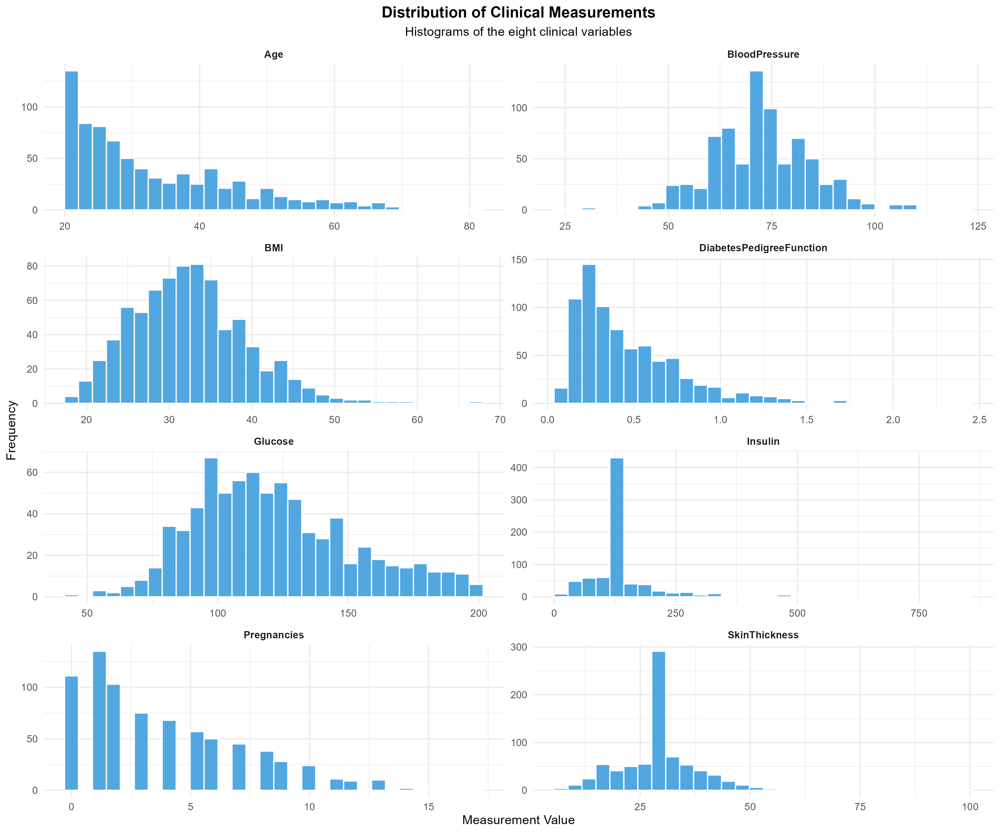

**Clinical variable density plots**

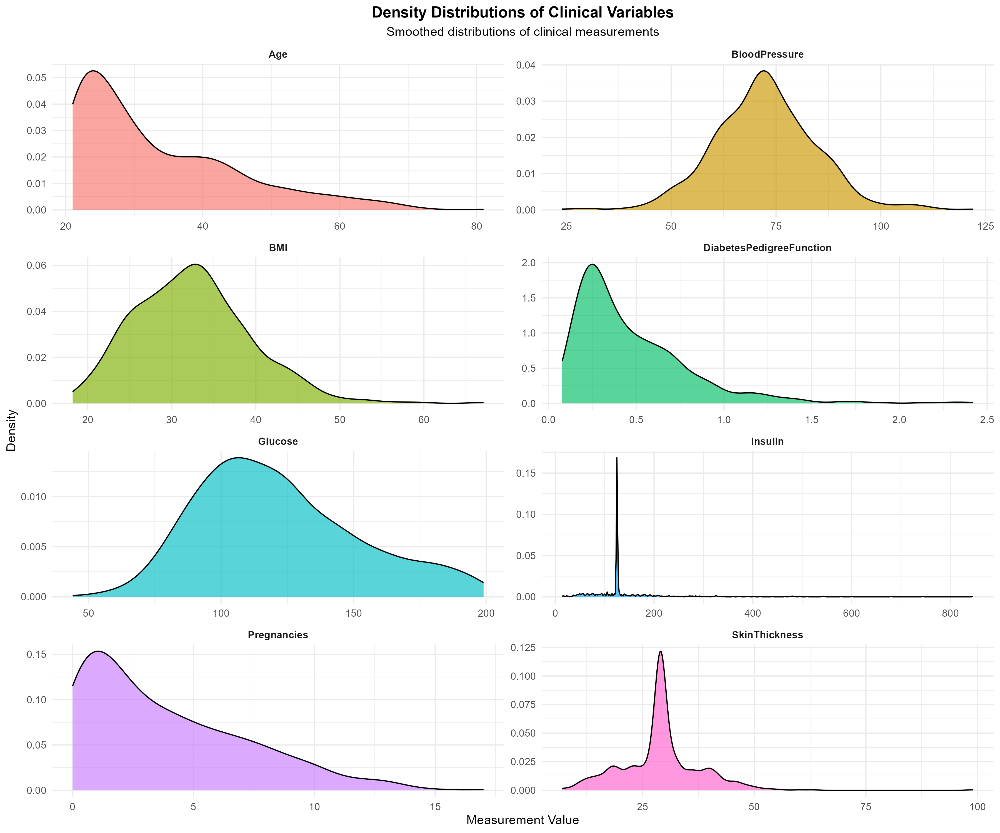

**Clinical measurements by outcome**

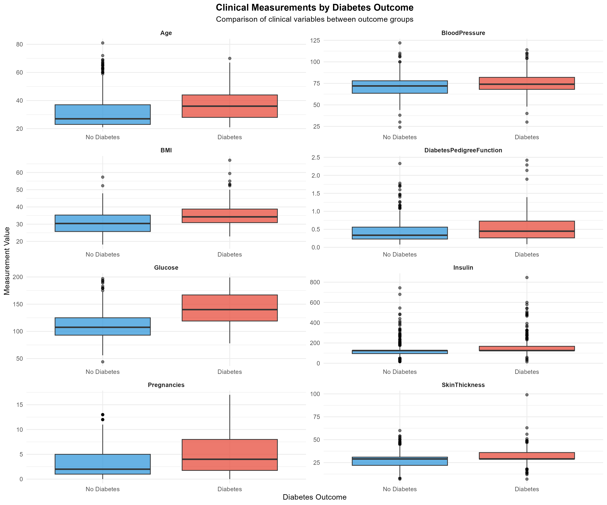

**Correlation heatmap**

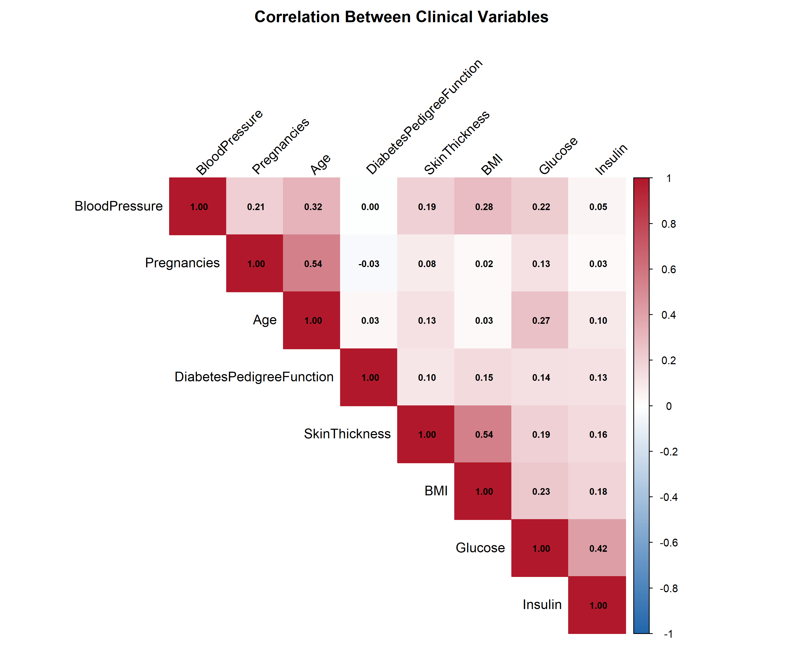

**Outcome correlations**

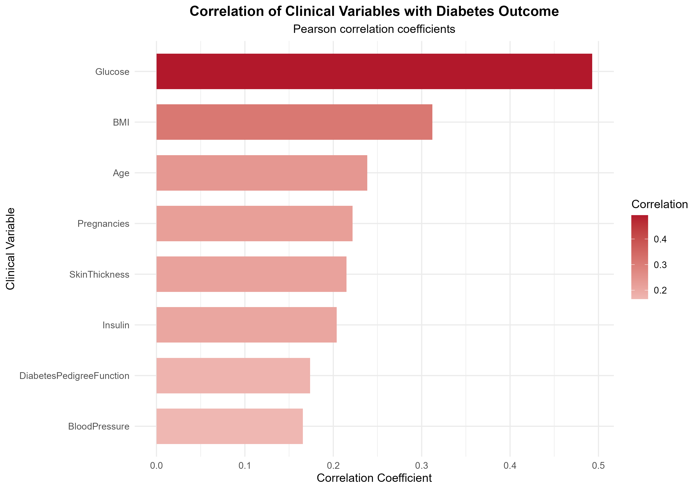

**Glucose and BMI relationship**

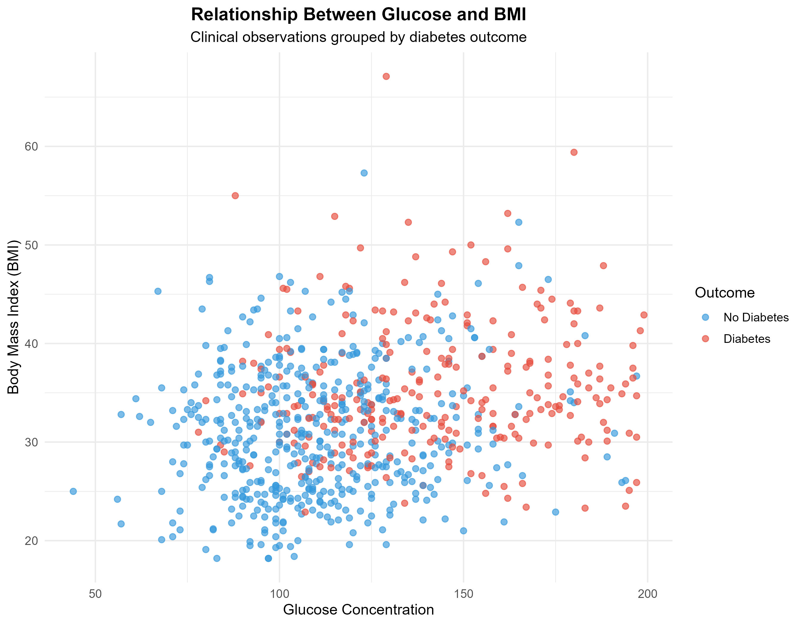

**Age distribution by outcome**

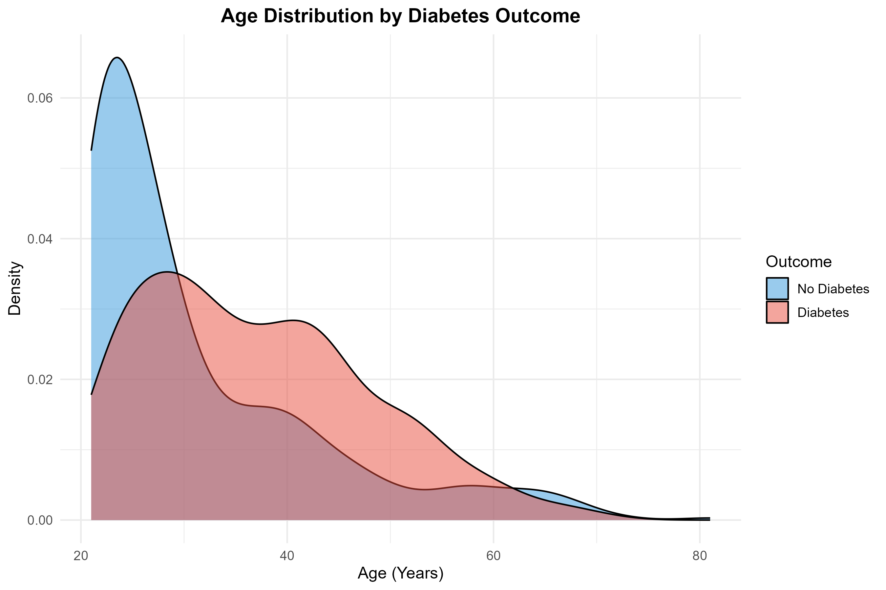

**Glucose distribution by outcome**

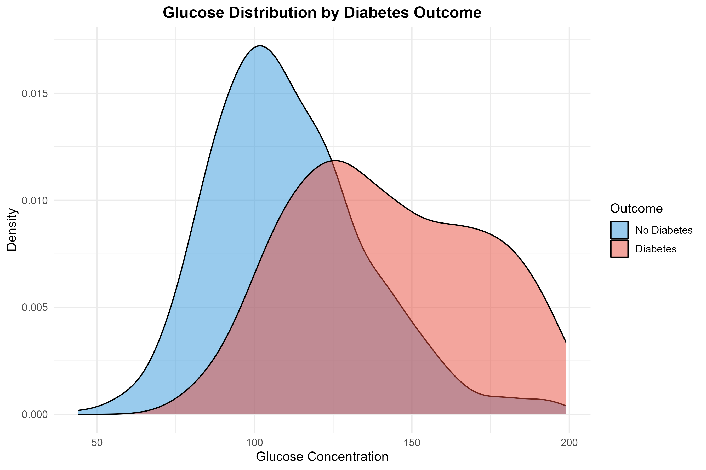

### 5.2 Statistical Testing Results

Statistical testing was performed to investigate differences between the diabetes outcome groups and relationships among clinical measurements.

#### Normality Assessment

The Shapiro-Wilk test was applied to all eight clinical variables.

All eight variables showed evidence against the normality assumption at the 0.05 significance level:

- Pregnancies
- Glucose
- BloodPressure
- SkinThickness
- Insulin
- BMI
- DiabetesPedigreeFunction
- Age

The results indicate that the distributions of the examined clinical measurements depart from a normal distribution.

Because the dataset contains 768 observations, the Shapiro-Wilk test can detect relatively small departures from normality. The results should therefore be interpreted alongside graphical assessments and the characteristics of the data.

#### Welch's Two-Sample t-Tests

Welch's t-tests were conducted to compare the mean values of the eight clinical variables between the No Diabetes and Diabetes groups.

All eight variables showed statistically significant differences after Benjamini-Hochberg adjustment, with adjusted p-values below 0.001.

| Variable | Mean: No Diabetes | Mean: Diabetes | Mean Difference |
|---|---:|---:|---:|
| Pregnancies | 3.30 | 4.87 | 1.57 |
| Glucose | 111 | 142 | 31.4 |
| BloodPressure | 70.9 | 75.1 | 4.20 |
| SkinThickness | 27.7 | 31.7 | 3.96 |
| Insulin | 128 | 165 | 36.9 |
| BMI | 30.9 | 35.4 | 4.50 |
| DiabetesPedigreeFunction | 0.430 | 0.550 | 0.121 |
| Age | 31.2 | 37.1 | 5.88 |

The Diabetes group had higher mean values across all eight variables in this dataset.

Glucose demonstrated the largest mean difference between the two outcome groups, approximately 31.4 units.

#### Wilcoxon Rank-Sum Tests

Wilcoxon rank-sum tests were also conducted to compare the distributions of the clinical variables between the two outcome groups.

All eight clinical variables demonstrated statistically significant differences after Benjamini-Hochberg adjustment (adjusted p < 0.001).

These findings provide additional evidence that the distributions of the clinical measurements differ between the No Diabetes and Diabetes groups.

#### Fligner-Killeen Variance Tests

Fligner-Killeen tests were used to investigate whether the variances of the clinical variables differed between the two outcome groups.

| Variable | Adjusted p-value | Interpretation |
|---|---:|---|
| Pregnancies | < 0.001 | Evidence of unequal variances |
| Glucose | < 0.001 | Evidence of unequal variances |
| BloodPressure | 0.693 | No significant evidence of unequal variances |
| SkinThickness | 0.170 | No significant evidence of unequal variances |
| Insulin | 0.693 | No significant evidence of unequal variances |
| BMI | 0.170 | No significant evidence of unequal variances |
| DiabetesPedigreeFunction | < 0.001 | Evidence of unequal variances |
| Age | 0.0007 | Evidence of unequal variances |

The results indicate evidence of unequal variances for Pregnancies, Glucose, DiabetesPedigreeFunction, and Age. The remaining four variables did not demonstrate statistically significant variance differences after adjustment.

#### Pearson and Spearman Correlation Analysis

Pearson and Spearman correlation analyses were conducted to investigate relationships between the clinical measurements and the binary diabetes outcome.

The outcome was numerically represented as:

- No Diabetes = 0
- Diabetes = 1

| Variable | Pearson Correlation | Spearman Correlation |
|---|---:|---:|
| Pregnancies | 0.222 | 0.199 |
| Glucose | 0.493 | 0.481 |
| BloodPressure | 0.166 | 0.171 |
| SkinThickness | 0.215 | 0.216 |
| Insulin | 0.204 | 0.274 |
| BMI | 0.312 | 0.307 |
| DiabetesPedigreeFunction | 0.174 | 0.175 |
| Age | 0.238 | 0.309 |

All eight variables showed positive correlations with the diabetes outcome in both correlation analyses. The reported correlation tests produced p-values below the displayed precision.

Glucose demonstrated the strongest positive association with the outcome, with a Pearson correlation of 0.493 and a Spearman correlation of 0.481.

BMI also showed a positive association, with Pearson and Spearman correlations of 0.312 and 0.307, respectively.

These findings describe associations within the dataset and should not be interpreted as evidence of causation.

#### Statistical Figures

**Group mean comparison**

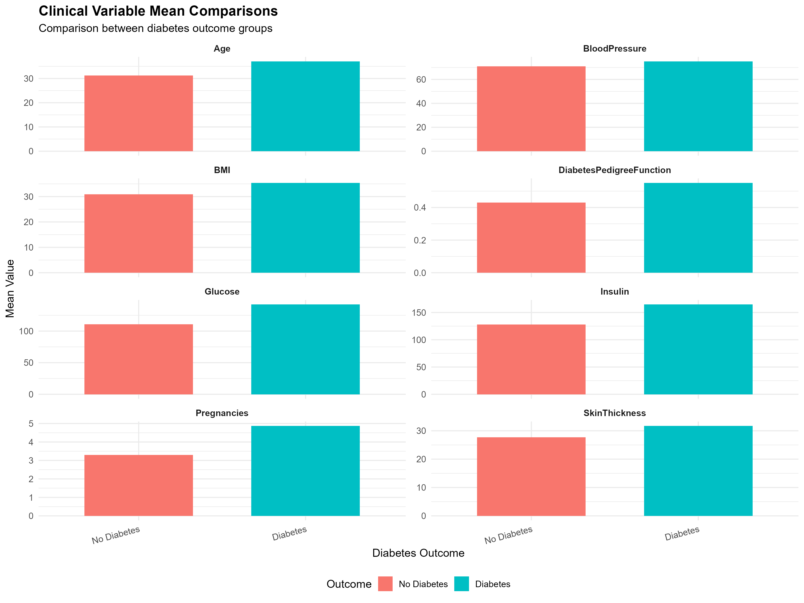

**Adjusted p-value comparison**

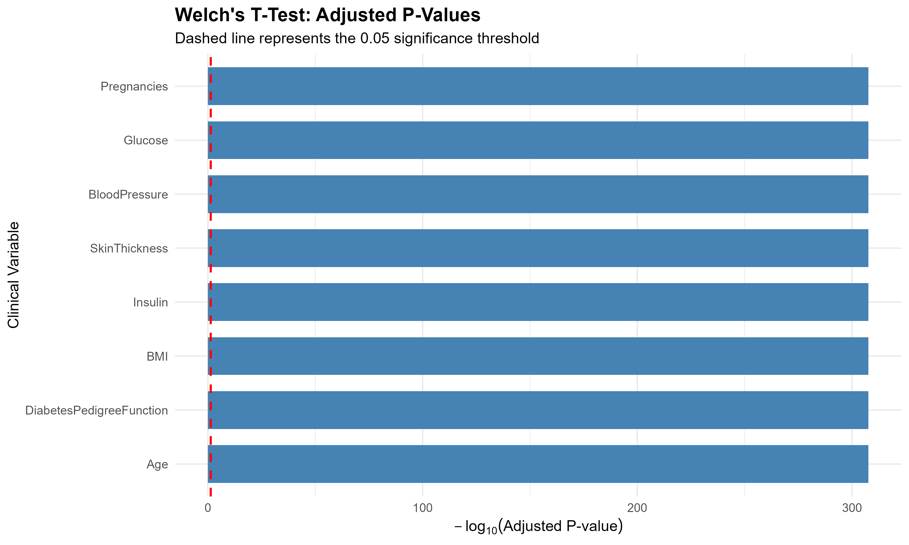

**Correlation comparison**

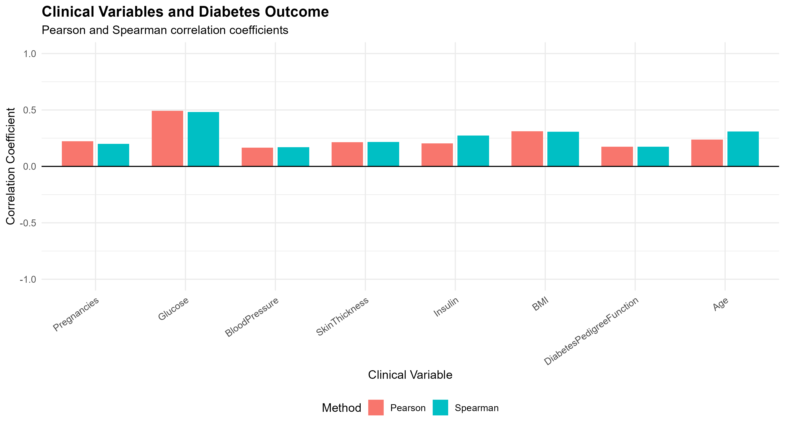

### 5.3 Predictive Modelling Results

All six methods were evaluated using the same testing dataset containing 154 observations.

| Method | Accuracy | Sensitivity | Specificity | Precision | F1-score | ROC-AUC |
|---|---:|---:|---:|---:|---:|---:|
| Logistic Regression | 0.8052 | 0.611 | 0.910 | 0.786 | 0.688 | 0.8911 |
| Naive Bayes | 0.7857 | 0.704 | 0.830 | 0.691 | 0.697 | 0.8717 |
| Decision Tree | 0.7792 | 0.500 | 0.930 | 0.794 | 0.614 | 0.8263 |
| k-Nearest Neighbours | 0.7468 | 0.630 | 0.810 | 0.642 | 0.636 | 0.7944 |
| Support Vector Machine | 0.7857 | 0.611 | 0.880 | 0.733 | 0.667 | 0.8819 |
| K-means Clustering | 0.7662 | 0.815 | 0.740 | 0.629 | 0.710 | 0.8493 |

**Model performance comparison**

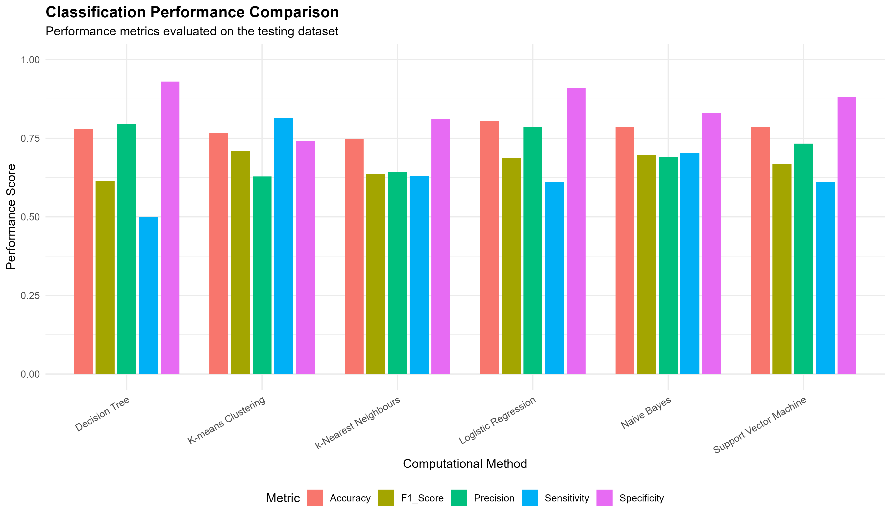

**ROC curve comparison**

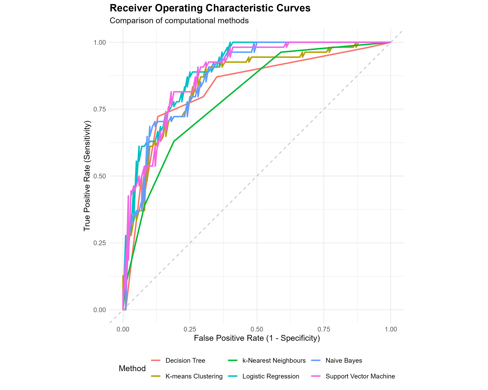

**ROC-AUC comparison**

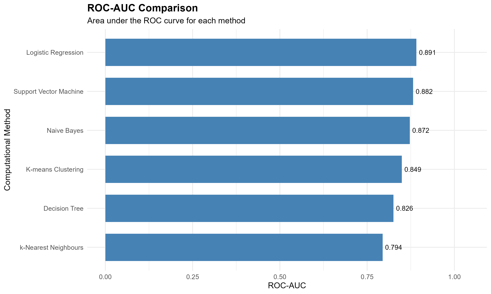

**Confusion matrix comparison**

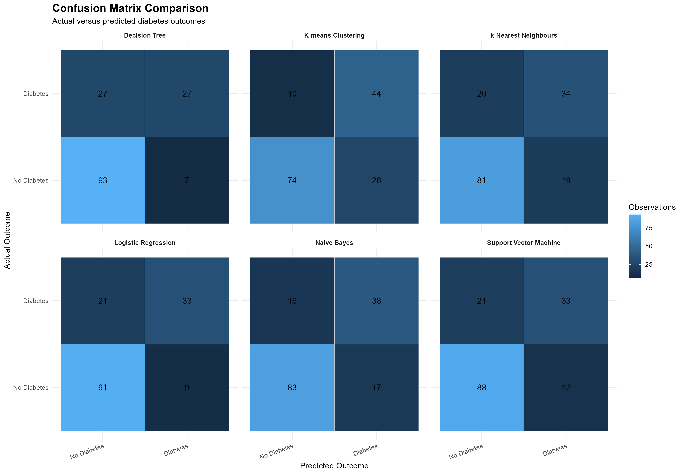

### 5.4 Confusion Matrix Results

The confusion matrices provide further information about the classification performance of each method.

For Logistic Regression:

| Actual / Predicted | No Diabetes | Diabetes |
|---|---:|---:|
| No Diabetes | 91 | 9 |
| Diabetes | 21 | 33 |

For Naive Bayes:

| Actual / Predicted | No Diabetes | Diabetes |
|---|---:|---:|
| No Diabetes | 83 | 17 |
| Diabetes | 16 | 38 |

For Decision Tree:

| Actual / Predicted | No Diabetes | Diabetes |
|---|---:|---:|
| No Diabetes | 93 | 7 |
| Diabetes | 27 | 27 |

For k-Nearest Neighbours:

| Actual / Predicted | No Diabetes | Diabetes |
|---|---:|---:|
| No Diabetes | 81 | 19 |
| Diabetes | 20 | 34 |

For Support Vector Machine:

| Actual / Predicted | No Diabetes | Diabetes |
|---|---:|---:|
| No Diabetes | 88 | 12 |
| Diabetes | 21 | 33 |

For K-means Clustering:

| Actual / Predicted | No Diabetes | Diabetes |
|---|---:|---:|
| No Diabetes | 74 | 26 |
| Diabetes | 10 | 44 |

### 5.5 Best Performing Method

Logistic Regression achieved the highest ROC-AUC value of 0.8911 and the highest accuracy of approximately 80.52%.

Naive Bayes achieved a sensitivity of approximately 70.4%, while K-means produced the highest sensitivity of approximately 81.5% and F1-score of approximately 0.710 in this experiment.

The Decision Tree achieved the highest specificity among the evaluated methods, at approximately 93.0%, but its sensitivity was approximately 50.0%.

These findings demonstrate that the best-performing method depends on the evaluation metric selected. Sensitivity is important when considering the identification of diabetes cases, whereas specificity measures how effectively non-diabetes cases are identified.

---

## 6. Discussion

The statistical analysis identified differences between the two diabetes outcome groups across all eight clinical measurements. Both Welch's t-tests and Wilcoxon rank-sum tests indicated statistically significant differences after multiple-testing adjustment.

The Shapiro-Wilk tests indicated evidence against normality for all eight variables. The use of both Welch's t-tests and Wilcoxon rank-sum tests therefore provides complementary information about differences between the groups. Welch's test compares means and does not require equal population variances, while the Wilcoxon test compares the distributions through ranks.

The correlation analysis identified Glucose as the variable with the strongest positive association with the diabetes outcome. BMI, Age, and Pregnancies also showed positive associations. These findings suggest that several clinical measurements are associated with the observed outcome, although correlation alone does not establish causation.

The Fligner-Killeen tests indicated that the variability of some clinical measurements differs between the two outcome groups. This reinforces the importance of examining distributional characteristics rather than relying only on mean comparisons.

In predictive modelling, Logistic Regression achieved the strongest ROC-AUC and overall accuracy. Its ROC-AUC of 0.8911 indicates good discrimination between the two outcome categories within the selected testing dataset.

The Support Vector Machine also demonstrated competitive performance, achieving an ROC-AUC of 0.8819. Naive Bayes achieved a higher sensitivity than Logistic Regression, suggesting that it identified a greater proportion of the observed diabetes cases in this particular testing experiment.

The Decision Tree achieved the highest specificity among the evaluated methods, but its sensitivity was lower. This demonstrates the importance of considering multiple evaluation metrics instead of relying exclusively on accuracy.

K-means achieved the highest sensitivity and F1-score in the reported comparison. However, because its clusters were assigned outcome labels using the training data, this result should be interpreted carefully. Its inverse-distance scores are ranking scores, not calibrated clinical probabilities.

Several limitations should also be considered.

First, the dataset contains a relatively small number of observations compared with many contemporary clinical datasets. Second, the original population is restricted to a specific demographic group, limiting generalization. Third, median imputation may not fully represent the underlying distribution of missing clinical measurements. Fourth, the results depend on a single stratified training/testing partition and may change with a different random partition.

Furthermore, the selected methods and parameters have not been established as clinically optimal. The reported results are therefore suitable for educational and computational comparison rather than medical decision-making.

---

## 7. Conclusion and Possible Future Work

This project successfully implemented a complete computational analysis workflow for the Pima Indians Diabetes Dataset using R.

The workflow included data importation, data cleaning, missing-value treatment, exploratory analysis, statistical testing, predictive modelling, and model evaluation.

The statistical analysis demonstrated significant differences between the diabetes outcome groups across all eight clinical variables. Glucose showed the strongest positive correlation with the diabetes outcome.

Six computational methods were evaluated. Logistic Regression achieved the highest ROC-AUC of 0.8911 and accuracy of approximately 80.52% in the testing dataset. The results also demonstrated differences in sensitivity, specificity, and F1-score among the evaluated methods.

The project highlights the importance of data preprocessing, statistical analysis, and appropriate evaluation metrics when investigating clinical datasets.

### Possible Future Work

The project can be extended through the following improvements:

1. Apply repeated stratified cross-validation to obtain more stable performance estimates.
2. Investigate additional approaches for handling missing clinical measurements.
3. Evaluate the effects of different parameter settings.
4. Investigate feature selection and its effect on classification performance.
5. Examine additional publicly available clinical datasets.
6. Compare results across different demographic populations where suitable data are available.
7. Investigate the interpretability of the relationships between clinical measurements and diabetes outcomes.
8. Perform external validation using an independent dataset.

Future investigations should prioritize appropriate validation and responsible interpretation before considering any real-world healthcare application.

---

## 8. Reproducibility

### Project Structure

The project follows the directory structure below:

```text
Diabetes_Prediction/
│
├── code/
│   ├── 01_data_import.R
│   ├── 02_data_cleaning.R
│   ├── 03_exploratory_analysis.R
│   ├── 04_statistical_testing.R
│   └── 05_predictive_modelling.R
│
├── data/
│   ├── 01_raw_diabetes.rds
│   ├── 02_clean_diabetes.rds
│   ├── 04_normality_tests.csv
│   ├── 04_welch_t_tests.csv
│   ├── 04_wilcoxon_tests.csv
│   ├── 04_variance_tests.csv
│   ├── 04_correlation_tests.csv
│   ├── 04_statistical_results.rds
│   ├── 05_model_performance.csv
│   ├── 05_confusion_matrices.csv
│   ├── 05_testing_predictions.csv
│   └── 05_predictive_results.rds
│
├── figures/
│   ├── 01_outcome_distribution.png
│   ├── 02_clinical_histograms.png
│   ├── 03_clinical_density_plots.png
│   ├── 04_clinical_boxplots_by_outcome.png
│   ├── 05_correlation_heatmap.png
│   ├── 06_outcome_correlation.png
│   ├── 07_glucose_bmi_scatterplot.png
│   ├── 08_age_distribution_by_outcome.png
│   ├── 09_glucose_distribution_by_outcome.png
│   ├── 10_statistical_comparison.png
│   ├── 11_pvalue_comparison.png
│   ├── 12_correlation_comparison.png
│   ├── 13_model_performance_comparison.png
│   ├── 14_roc_curve_comparison.png
│   ├── 15_roc_auc_comparison.png
│   └── 16_confusion_matrix_comparison.png
│
└── README.md
```

Other generated files, such as descriptive statistics and preprocessing summaries, may also be present in the `data/` directory.

### Software Requirements

- R programming language.
- RStudio (recommended).
- Internet connection for the initial dataset import.
- Required R packages:
  - `tidyverse`
  - `caret`
  - `e1071`
  - `rpart`
  - `pROC`

The `class` package is also used for k-NN and is included with standard R recommended packages.

### Installation

Install the required packages in the R console:

```r
install.packages(c(
  "tidyverse",
  "caret",
  "e1071",
  "rpart",
  "pROC"
))
```

Check the installed R version:

```r
R.version.string
```

### Running the Project

Clone or download the project repository and open the project root directory in RStudio.

Execute the scripts in the following order:

**Step 1 – Data Importation**

```r
source("code/01_data_import.R")
```

**Step 2 – Data Cleaning**

```r
source("code/02_data_cleaning.R")
```

**Step 3 – Exploratory Data Analysis**

```r
source("code/03_exploratory_analysis.R")
```

**Step 4 – Statistical Testing**

```r
source("code/04_statistical_testing.R")
```

**Step 5 – Predictive Modelling**

```r
source("code/05_predictive_modelling.R")
```

Each script generates intermediate or final files required by subsequent stages. Therefore, the scripts should be executed in the specified order.

For a fresh execution, the `data/` directory should be prepared according to the scripts' expected output paths. The first script downloads the dataset and generates the initial RDS file. Subsequent scripts use the saved outputs rather than requiring manual data entry.

### Reproducibility Considerations

A fixed random seed of `123` is used in the predictive modelling script to make the data partitioning and stochastic procedures reproducible under the same software and package environment.

The training and testing datasets are separated before standardization. Means and standard deviations are calculated using the training data and then applied to the testing data.

Intermediate datasets, model results, evaluation metrics, and figures are saved to support further inspection and verification.

For best reproducibility, record the R version and package versions used in the final execution. Package versions can be recorded with:

```r
sessionInfo()
```

---

## 9. References

Plotly. (n.d.). *Diabetes dataset* [Data set]. GitHub. https://github.com/plotly/datasets/blob/master/diabetes.csv

R Core Team. (n.d.). *R: A language and environment for statistical computing*. R Foundation for Statistical Computing. https://www.r-project.org/

Smith, J. W., Everhart, J. E., Dickson, W. C., Knowler, W. C., & Johannes, R. S. (1988). Using the ADAP learning algorithm to forecast the onset of diabetes mellitus. In *Proceedings of the Annual Symposium on Computer Application in Medical Care* (pp. 261–265).

Meyer, D., Dimitriadou, E., Hornik, K., Weingessel, A., & Leisch, F. (2024). *e1071: Misc functions of the Department of Statistics, Probability Theory Group (Formerly: E1071), TU Wien* [R package]. CRAN. https://CRAN.R-project.org/package=e1071

Therneau, T., Atkinson, B., & Ripley, B. (2024). *rpart: Recursive partitioning and regression trees* [R package]. CRAN. https://CRAN.R-project.org/package=rpart

Robin, X., Turck, N., Hainard, A., Tiberti, N., Lisacek, F., Sanchez, J.-C., & Müller, M. (2011). pROC: An open-source package for R and S+ to analyze and compare ROC curves. *BMC Bioinformatics, 12*, Article 77. https://doi.org/10.1186/1471-2105-12-77

Wickham, H., Averick, M., Bryan, J., Chang, W., McGowan, L. D., François, R., Grolemund, G., Hayes, A., Henry, L., Hester, J., Kuhn, M., Pedersen, T. L., Miller, E., Bache, S. M., Müller, K., Ooms, J., Robinson, D., Seidel, D. P., Spinu, V., ... Yutani, H. (2019). Welcome to the tidyverse. *Journal of Open Source Software, 4*(43), 1686. https://doi.org/10.21105/joss.01686